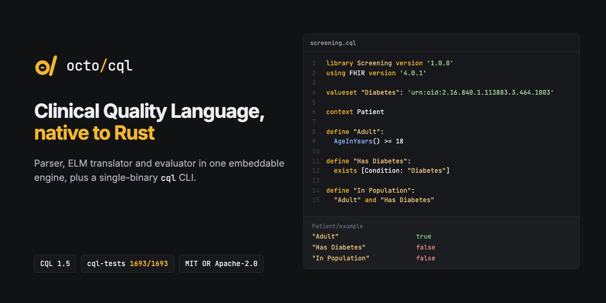

<p align="center"></p>

<p align="center">
  <a href="https://github.com/octofhir/cql-rs/actions/workflows/ci.yml"></a>
  <a href="https://crates.io/crates/octofhir-cql"></a>
  <a href="https://docs.rs/octofhir-cql"></a>
  <a href="#license"></a>
</p>

# octofhir-cql

**A pure-Rust engine for [HL7 Clinical Quality Language](https://cql.hl7.org/) 1.5: parse CQL, translate it to ELM, and evaluate it, against FHIR data or your own. Ships as an embeddable library and a single `cql` binary.**

- **Conformant.** Passes **1693 of 1693** tests (100%) in the 14 suites of the official
  [cqframework/cql-tests](https://github.com/cqframework/cql-tests), run in CI.
- **FHIR-ready.** Evaluates measure-style libraries end to end: `using FHIR`, `include ... called`,
  code systems, value sets, codes and concepts, parameters with defaults, `context Patient`,
  terminology-filtered retrieves, `with`/`without ... such that`, `let`, user-defined and fluent
  functions, and age and timing operators. Data comes from FHIR R4 JSON (resources, Bundles, NDJSON).
- **Embeddable.** No JVM, no translator service, no network. The engine is plain Rust behind two small
  traits (`DataProvider`, `TerminologyProvider`), so you can plug in a FHIR server, a database or
  in-memory data.
- **Standard output.** Translates CQL to HL7 ELM JSON (`{ "library": ... }`), with name resolution
  and diagnostics that carry line and column.
- **One binary.** `cql parse | translate | validate | eval | repl`. Evaluate a measure for every
  patient in a bundle with a single command.

## Install

### Prebuilt `cql` binaries

Every [GitHub Release](https://github.com/octofhir/cql-rs/releases) carries standalone binaries:

| Platform | Asset |
|----------|-------|
| Linux x86-64 | `cql-linux-x64` |
| Linux ARM64 | `cql-linux-arm64` |
| macOS Intel | `cql-macos-x64` |
| macOS Apple silicon | `cql-macos-arm64` |
| Windows x86-64 | `cql-windows-x64.exe` |

```bash
curl -L -o cql https://github.com/octofhir/cql-rs/releases/latest/download/cql-macos-arm64
chmod +x cql && ./cql --version
```

### With Cargo

```bash
cargo install octofhir-cql
```

### As a library

```toml
[dependencies]
octofhir-cql = { version = "0.2.2", default-features = false }
# Enable the `cli` feature only when you also need the command-line binary.
```

## Quick start: CLI

The example files below are in [`crates/octofhir-cql/tests/fixtures`](crates/octofhir-cql/tests/fixtures):
a diabetes HbA1c measure (`DiabetesScreening.cql`), the library it includes (`CommonLogic.cql`) and a
FHIR Bundle with two patients and the value sets (`diabetes-bundle.json`).

```bash
$ cql eval DiabetesScreening.cql --data diabetes-bundle.json \
    -e "Initial Population" -e "Denominator" -e "Numerator" -e "Most Recent HbA1c Value"
{
  "adult-diabetic": {
    "Denominator": true,
    "Initial Population": true,
    "Most Recent HbA1c Value": {
      "unit": "%",
      "value": 9.5
    },
    "Numerator": true
  },
  "child": {
    "Denominator": false,
    "Initial Population": false,
    "Most Recent HbA1c Value": null,
    "Numerator": null
  }
}
```

Libraries with `context Patient` are evaluated once per Patient in the data (`--patient <id>` picks
some). Included libraries are found next to the main file or in `-L <dir>`.

```bash
# Parameters are CQL expressions; --now fixes Now()/Today()
cql eval DiabetesScreening.cql -d diabetes-bundle.json \
  -p '"Measurement Period"=Interval[@2024-01-01T00:00:00Z, @2025-01-01T00:00:00Z)' \
  -p '"HbA1c Threshold"=8.0' --now 2024-12-31

cql translate DiabetesScreening.cql -o DiabetesScreening.json   # ELM JSON
cql validate *.cql                                               # exit code 1 on errors
cql parse CommonLogic.cql                                        # AST as JSON
cql repl --data diabetes-bundle.json --patient adult-diabetic    # interactive
```

`validate` reports syntax and name-resolution errors with their location:

```text
Broken.cql:2:11: error[CQL0012]: an expression, found `1`
  |
2 | define A: 1 +
  |           ^
```

## Quick start: library

Compile a library (with its includes) and evaluate every definition:

```rust
use octofhir_cql::CompiledLibrary;
use octofhir_cql::types::CqlValue;

fn main() -> Result<(), Box<dyn std::error::Error>> {
    let library = CompiledLibrary::compile(
        r#"
        library Example version '1.0.0'

        define "Sum": 1 + 2
        define "Contains Five": Interval[1, 10] contains 5
        define function "Double"(x Integer): x * 2
        define "Doubled": { 1, 2, 3 } N return "Double"(N)
        "#,
    )?;

    let results = library.evaluate(&mut library.context())?;
    assert_eq!(results["Sum"], CqlValue::Integer(3));
    assert_eq!(results["Contains Five"], CqlValue::Boolean(true));
    assert_eq!(results["Doubled"].to_string(), "{2, 4, 6}");
    Ok(())
}
```

Evaluate against FHIR data in memory: resources become CQL values, and value sets are read from
`ValueSet` resources in the same data:

```rust
use octofhir_cql::CompiledLibrary;
use octofhir_cql::eval::fhir::InMemoryFhirData;
use octofhir_cql::eval::{DataProvider, TerminologyProvider};
use octofhir_cql::types::CqlValue;
use serde_json::json;
use std::sync::Arc;

fn main() -> Result<(), Box<dyn std::error::Error>> {
    let mut data = InMemoryFhirData::new();
    data.add_json(&json!({
        "resourceType": "Bundle",
        "entry": [
            { "resource": { "resourceType": "Patient", "id": "p1", "birthDate": "1980-05-20" } },
            { "resource": {
                "resourceType": "Observation", "id": "o1", "status": "final",
                "subject": { "reference": "Patient/p1" },
                "code": { "coding": [{ "system": "http://loinc.org", "code": "4548-4" }] },
                "valueQuantity": { "value": 7.2, "unit": "%",
                                   "system": "http://unitsofmeasure.org", "code": "%" } } }
        ]
    }));
    let data = Arc::new(data);

    let library = CompiledLibrary::compile(
        r#"
        library HbA1c
        using FHIR version '4.0.1'
        codesystem "LOINC": 'http://loinc.org'
        code "HbA1c": '4548-4' from "LOINC"
        context Patient

        define "Adult": AgeInYearsAt(@2024-01-01) >= 18
        define "HbA1c Values": [Observation: "HbA1c"] O where O.status = 'final' return O.value
        define "Controlled": AllTrue("HbA1c Values" V return V < 8 '%')
        "#,
    )?;

    let patient = data.resources("Patient")[0].clone();
    let mut ctx = library
        .context()
        .with_context("Patient", patient)
        .with_data_provider(data.clone() as Arc<dyn DataProvider>)
        .with_terminology_provider(data as Arc<dyn TerminologyProvider>);

    let results = library.evaluate(&mut ctx)?;
    assert_eq!(results["Adult"], CqlValue::Boolean(true));
    assert_eq!(results["Controlled"], CqlValue::Boolean(true));
    Ok(())
}
```

To read data from somewhere else, implement `DataProvider` (and optionally `TerminologyProvider`);
see the [`octofhir-cql-eval` README](crates/octofhir-cql-eval/README.md).

## FHIR data model

CQL written against FHIR relies on `FHIRHelpers` to turn FHIR elements into CQL values. This engine
applies those conversions when FHIR JSON is loaded
([`octofhir_cql::model::fhir::json`](crates/octofhir-cql-model/src/fhir/json.rs)):

| FHIR | CQL |
|------|-----|
| `boolean`, `integer`, `decimal`, `string`/`code`/`uri`/... | `Boolean`, `Integer`, `Decimal`, `String` |
| `date`, `dateTime`/`instant`, `time` | `Date`, `DateTime`, `Time` |
| `Coding`, `CodeableConcept` | `Code`, `Concept` |
| `Quantity` (and `Age`, `Duration`, ...) | `Quantity` (UCUM code) |
| `Period`, `Range`, `Ratio` | `Interval<DateTime>`, `Interval<Quantity>`, `Ratio` |
| choice elements (`effectiveDateTime`, `valueQuantity`) | `effective`, `value` with the suffix's type |
| resources, other complex types | tuples (keeping `resourceType`) |

`FHIRHelpers` can therefore be included without its source: its `ToX` conversions are built into the
evaluator. Type tests understand FHIR names (`x is FHIR.Period`, `x is Observation`) and
QICore-style helpers over system types (`Choice<DateTime, Interval<DateTime>>`) work unchanged.

## Conformance

| Suite | Result |
|-------|--------|
| [cqframework/cql-tests](https://github.com/cqframework/cql-tests) (14 suites, vendored) | **1693 / 1693 (100%)** |
| End-to-end measure library (include, value sets, retrieves, per-patient evaluation, FHIR type tests) | 6 tests, all passing |
| `cql` binary (eval, translate, validate, parse, REPL) | 9 tests, all passing |
| Tests extracted from google/cql engine tests (informational, not a release gate) | 807 / 1168 |

The cql-tests suites cover aggregate, arithmetic, comparison, conditional, date/time, interval, list,
logical, nullological, string and type operators, queries, types, and value literals and selectors.
Reproduce with:

```bash
cargo test -p octofhir-cql --test cqframework_spec_tests -- --nocapture
```

## Architecture

```text
 CQL text ──► octofhir-cql-parser ──► AST (octofhir-cql-ast)
                                        │
                                        ▼
                         octofhir-cql-elm: AstToElmConverter ──► ELM JSON
                         (name resolution, includes, diagnostics)
                                        │
                                        ▼
            octofhir-cql-eval: CqlEngine + EvaluationContext ◄── DataProvider / TerminologyProvider
                                        │                        (FHIR in memory, server, database)
                                        ▼
                                CQL values (octofhir-cql-types)
```

| Crate | Role |
|-------|------|
| [`octofhir-cql`](crates/octofhir-cql) | Entry point: re-exports, `CompiledLibrary` (compile with includes, evaluate), the `cql` CLI |
| [`octofhir-cql-parser`](crates/octofhir-cql-parser) | CQL 1.5 parser (winnow) with located errors and error recovery |
| [`octofhir-cql-ast`](crates/octofhir-cql-ast) | Syntax tree, serializable to JSON |
| [`octofhir-cql-elm`](crates/octofhir-cql-elm) | ELM model, CQL-to-ELM translation, ELM JSON |
| [`octofhir-cql-eval`](crates/octofhir-cql-eval) | Evaluation engine, operators, provider traits, in-memory FHIR provider |
| [`octofhir-cql-types`](crates/octofhir-cql-types) | CQL values and types (`CqlValue`, temporal, quantity, interval, ...) |
| [`octofhir-cql-model`](crates/octofhir-cql-model) | FHIR JSON ⇄ CQL values, ModelInfo parsing, async retriever trait |
| [`octofhir-cql-diagnostics`](crates/octofhir-cql-diagnostics) | Error codes, spans, source locations |

## Limitations

- **No static type checking in the translator.** ELM carries no result types and no implicit
  conversions; overloads of user-defined functions are chosen at run time by arity and argument values.
  Type errors surface during evaluation, not in `validate`.
- **FHIR typing without StructureDefinitions.** The FHIR mapping uses element names and value shapes.
  A `string` element whose value looks like a `dateTime` with a time part is read as a `DateTime`.
- **Terminology is local.** The in-memory provider knows enumerated value sets (`expansion` or
  `compose.include.concept`); `filter`-based definitions are not evaluated, and value set versions are
  not checked. Other terminology services plug in through `TerminologyProvider`.
- **No measure scoring.** The engine evaluates CQL definitions. It does not process `Measure`
  resources or produce `MeasureReport`s.
- **Not yet supported:** related-context retrieves (`[Mother -> Observation]` parses but is evaluated
  in the current context) and `external` functions (an evaluation error).
- **Diagnostics locations.** Parse errors point at the offending token. Name-resolution errors point
  at the enclosing definition, because expression-level spans are not tracked yet.
- **ELM JSON only.** ELM XML is not supported, by design.

## Development

```bash
cargo test --workspace                     # all tests
cargo clippy --workspace --all-targets -- -D warnings
cargo run -p octofhir-cql --bin cql -- --help
```

## License

Licensed under either of

- Apache License, Version 2.0 ([LICENSE-APACHE](LICENSE-APACHE) or <http://www.apache.org/licenses/LICENSE-2.0>)
- MIT license ([LICENSE-MIT](LICENSE-MIT) or <http://opensource.org/licenses/MIT>)

at your option.

Unless you explicitly state otherwise, any contribution intentionally submitted for inclusion in this project by you, as defined in the Apache-2.0 license, shall be dual licensed as above, without any additional terms or conditions.
